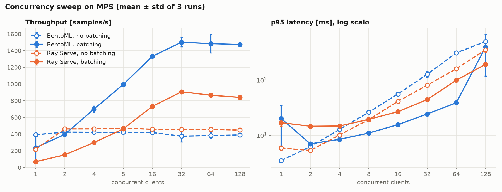
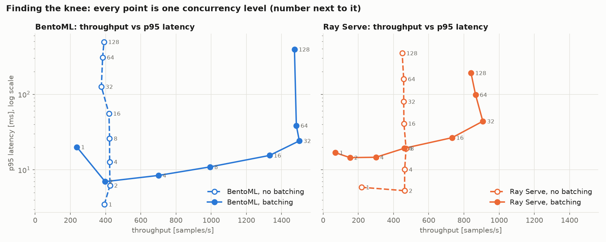
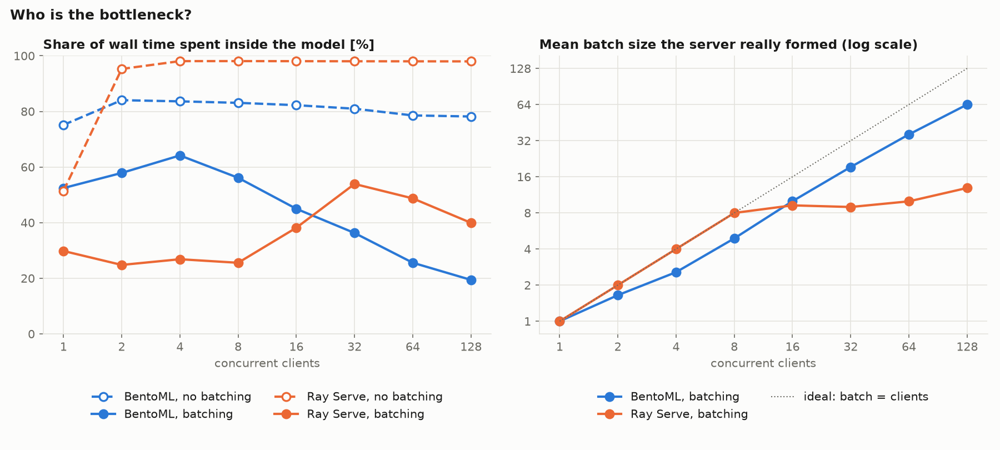

# Lab 2 (HW2): serving a model as an API + dynamic batching benchmark

Task: [`homeworks/HOMEWORK2.MD`](../homeworks/HOMEWORK2.MD) · Wersja polska: [README.md](README.md)

The HW1 model (CIFAR-10 classifier, a small ResNet, `models/lab1/best`, 90.73% test accuracy) is served as a
REST API with **two** tools and benchmarked with and without batching:

| Tool | Batching | Configured in |
|---|---|---|
| **BentoML 1.4.40** | adaptive (`batchable=True`, `max_batch_size`, `max_latency_ms`) | [`service.py`](service.py) |
| **Ray Serve 2.60.0** | dynamic with a fixed window (`@serve.batch`, `max_batch_size`, `batch_wait_timeout_s`) | [`ray_app.py`](ray_app.py) |

Results: [`results/results.md`](results/results.md) (tables) and the plots in [`results/`](results/).

## Presentation (5 min): plan and what we say

| # | Point | Time | Where in this file |
|---|---|---|---|
| 1 | Model and task, tools and why | 0:30 | below + [Why…](#why-best-mps-and-these-two-tools) |
| 2 | Code: where batching is configured | 0:30 | below |
| 3 | Live request | 0:30 | below + [Example request](#example-request-live) |
| 4 | Question to the audience, then the comparison table | 0:45 | [The four configurations side by side](#the-four-configurations-side-by-side) |
| 5 | The knee | 0:30 | [The knee](#the-knee-concurrency-1128) |
| 6 | The bottleneck | 0:45 | [Who is the bottleneck?](#who-is-the-bottleneck) |
| 7 | Dynamic vs adaptive + hysteresis | 0:45 | [Dynamic vs adaptive batching](#dynamic-ray-serve-vs-adaptive-bentoml-batching) |
| 8 | Production recommendation | 0:20 | [Production recommendation](#production-recommendation) |
| 9 | Problems + one-sentence takeaway | 0:25 | [Problems](#problems-worth-knowing-about) + below |

**1. Model and task (a reminder from HW1).** CIFAR-10 image classification: 10 classes, 32×32 colour images. The model is
a small ResNet in PyTorch Lightning, with hyperparameters tuned by Optuna (`models/lab1/best`). It has 692k parameters
and 90.73% test accuracy. For serving it is exported to TorchScript (`export_model.py`), with normalisation and
softmax inside, so the server receives raw image bytes. Accuracy after export is unchanged.
Tools: **BentoML** (adaptive batching) and **Ray Serve** (dynamic batching with a fixed window). They show the
difference between the two kinds of batching well, and both run natively on a Mac with GPU access (MPS).
Triton runs on a Mac only in Docker, without the GPU.

**2. Where batching is configured.** The model and the shared code (`common.py`) are identical for both tools; only
this part differs.

BentoML ([`service.py`](service.py)): one decorator; the dispatcher assembles the batch by itself.

```python
batching_options = (
    {"batchable": True, "batch_dim": 0, "max_batch_size": MAX_BATCH_SIZE, "max_latency_ms": MAX_LATENCY_MS}
    if BATCHING
    else {"batchable": False}
)

@bentoml.api(**batching_options)
def predict(self, images: list[str]) -> list[dict]:
    # with batching on, `images` is the concatenation of the lists of many requests
    return self.runner.predict(images)
```

Ray Serve ([`ray_app.py`](ray_app.py)): `@serve.batch` hands us a list of requests, and we split the results back ourselves.

```python
@serve.batch(max_batch_size=MAX_BATCH_SIZE, batch_wait_timeout_s=BATCH_WAIT_MS / 1000)
async def _predict_batched(self, requests: list[list[str]]) -> list[list[dict]]:
    flat = [image for images in requests for image in images]
    predictions = await self._run(flat)
    ...  # split predictions back, one list per request
```

Parameters: `max_batch_size=64` in both; BentoML `max_latency_ms=1000` (a latency budget, not a window); Ray Serve
a 5 ms window.

**3. Live request** (start the server in a separate terminal before the talk):

```bash
cd lab2 && source .venv/bin/activate
BATCHING=1 bentoml serve service:CifarClassifier --port 3111          # terminal 1, starts in ~10 s

curl -s -X POST http://127.0.0.1:3111/predict \
     -H 'content-type: application/json' -d @sample_request.json      # terminal 2
# [{"label": "cat", "class_id": 3, "confidence": 0.9572}]
python client_example.py                                              # 8 test-set images
```

**4. Question to the audience before showing the table:** "Which tool won, and how much did batching help: 1.5×, 3× or 10×?"
Answer: BentoML; batching gave 3.5× in BentoML and 1.9× in Ray Serve. The bare model on the GPU would give ~20× (batch 64 vs 1),
but HTTP and Python overhead eat the rest (point 6).

**9. One-sentence takeaway:** *Before you turn on batching, measure where the time goes. Here batching gave 3.5×
because a model call on the GPU costs almost the same whatever the batch size. Beyond that the limit is the Python
process handling HTTP, not the GPU. The next step is more replicas, not bigger batches.*

## Why `best`, MPS and these two tools

* **The `best` model** is the most accurate of the three HW1 models (90.7% vs 85.5% and 77.9%) and the largest
  (692k parameters), so batching has the most to gain relative to HTTP overhead.
* **Device: the Apple Silicon GPU (MPS).** The bare model (no HTTP) on MPS: 1 image ≈ 2.4 ms, a batch of 64 ≈ 6.7 ms,
  so throughput goes from about 420 to about 9,500 samples/s. On CPU batching gives at most about 1.5×.
  A shorter control run on CPU is included.
* **BentoML** has truly *adaptive* batching, which the task asks for. **Ray Serve** has classic *dynamic* batching
  with a fixed window, so it shows the difference well. Both run natively on macOS with access to MPS.
  Triton would run on a Mac only in Docker, and a container on macOS has no GPU access.

## Layout

```
lab2/
├── export_model.py        # Lightning checkpoint -> TorchScript (models/lab2/model.pt) + accuracy check
├── common.py              # code shared by both servers: model loading, input decoding, inference, stats
├── service.py             # BentoML service (port 3111)
├── ray_app.py             # Ray Serve application
├── ray_serve.yaml         # Ray Serve config (port 8111, no access logs)
├── client_example.py      # example client (requests)
├── sample_request.json    # ready-made cURL request (1 image, true class: cat)
├── benchmark/
│   ├── loadtest.py        # one measurement: N concurrent clients, warm-up + 60 s window
│   ├── run_benchmark.py   # the whole benchmark: tools × batching × concurrency × repeats
│   ├── hysteresis.py      # does adaptive batching remember past traffic? (1 client before/after a burst)
│   ├── find_bottleneck.py # GPU utilisation under load + cost of each step of a request
│   └── make_report.py     # tables (results/results.md) and plots (results/*.png)
└── results/
    ├── raw.jsonl          # raw results (1 line = 1 measurement), MPS
    ├── raw_cpu.jsonl      # CPU control run
    ├── hysteresis.jsonl, bottleneck.json
    ├── results.md         # tables
    ├── sweep.png, knee.png, bottleneck.png
    └── invalid_run1/, invalid_run2_*/   # discarded measurements (see "Problems")
```

The exported model goes to `models/lab2/` (`model.pt`, `model_info.json`, sample test images).

## Environment

Python 3.12, a separate environment as in lab1:

```bash
cd lab2
uv python install 3.12
uv venv --python 3.12 .venv
source .venv/bin/activate
uv pip install -r requirements.txt
touch .venv/.metadata_never_index   # macOS: Spotlight indexing a fresh .venv eats several cores
```

## Running

```bash
python export_model.py      # once: models/lab1/best/best.ckpt -> models/lab2/model.pt

# BentoML (http://127.0.0.1:3111)
BATCHING=1 bentoml serve service:CifarClassifier --port 3111   # with adaptive batching
BATCHING=0 bentoml serve service:CifarClassifier --port 3111   # without batching

# Ray Serve (http://127.0.0.1:8111)
BATCHING=1 serve run ray_serve.yaml   # with dynamic batching
BATCHING=0 serve run ray_serve.yaml   # without batching
```

Ports 3111/8111 instead of the default 3000/8000, which are often taken (here by Docker containers).

Environment variables (read by `common.py`, `service.py` and `ray_app.py`):

| Variable | Default | Meaning |
|---|---|---|
| `BATCHING` | `1` | `1` = batching on, `0` = off |
| `DEVICE` | `mps` (if available) | `mps`, `cpu` or `cuda` |
| `MAX_BATCH_SIZE` | `64` | maximum batch size (both tools) |
| `MAX_LATENCY_MS` | `1000` | BentoML: per-request latency budget |
| `BATCH_WAIT_MS` | `5` | Ray Serve: fixed batching window |
| `TORCH_THREADS` | `4` | PyTorch threads on CPU |

## API and example request

`POST /predict` takes JSON `{"images": [...]}`, where each image is base64 of its 3,072 raw bytes
(32×32×3, RGB, `uint8`). It returns one prediction per image. Normalisation and softmax are built into the exported model.

```bash
curl -s -X POST http://127.0.0.1:3111/predict \
     -H 'content-type: application/json' -d @sample_request.json
```

```json
[{"label": "cat", "class_id": 3, "confidence": 0.9572}]
```

Python client (8 test-set images):

```bash
python client_example.py                              # BentoML
python client_example.py --url http://127.0.0.1:8111  # Ray Serve
```

Both servers also expose `POST /stats` (a histogram of the batch sizes the batcher really formed and the time spent
in the model) and `POST /reset_stats`.

## Benchmark

```bash
python benchmark/run_benchmark.py      # full run (~2 h): 2 tools × 2 modes × 8 levels × 3 repeats
python benchmark/run_benchmark.py --tools bentoml --device cpu --concurrency 1 8 32 --tag cpu --out results/raw_cpu.jsonl
python benchmark/hysteresis.py         # batching hysteresis (BentoML; --tool ray as a control)
python benchmark/find_bottleneck.py    # GPU utilisation + cost of each step of a request
python benchmark/make_report.py        # tables and plots
python benchmark/loadtest.py --url http://127.0.0.1:3111 --concurrency 32   # one measurement against a running server
```

Methodology (as required by the task):

* **Throughput** in samples/s over a fixed **60 s** window; 1 request = 1 image, so requests/s = samples/s.
* **Latency** p50/p95/p99 measured on the client side.
* **15 s warm-up** discarded before every measurement; the server also warms the model up at start-up.
* **Concurrency** 1, 2, 4, 8, 16, 32, 64, 128 closed-loop clients (each sends its next request once it gets a response).
* **3 repeats**, reported as mean ± standard deviation. Repeats are the outer loop, so slow drift of the machine is
  spread over all levels.
* **Same conditions** for every configuration: same model, same image, 1 replica/1 worker, the same machine for client
  and server. Every measurement records the power source and Low Power Mode; the benchmark refuses to start on battery.
* **The client is not the bottleneck:** clients are spread over at most 4 processes (asyncio + aiohttp); the CPU use of
  the busiest client process is recorded (about 5% of one core).
* For the bottleneck analysis every measurement also records the batch sizes really formed, the share of time spent
  in the model and the CPU use of every server process (psutil).

Hardware: **Apple M3 Pro** (11 CPU cores, 18 GB RAM, GPU via MPS), macOS 26 (Darwin 25.5), PyTorch 2.5.1.
Client and server on the same machine.

Batching parameters: `max_batch_size=64` (both), BentoML `max_latency_ms=1000`, Ray Serve `batch_wait_timeout_s=0.005`.

## Results

Full tables (all levels, mean ± std, p50/p95/p99, batch sizes, CPU): [`results/results.md`](results/results.md).
Conditions: MPS, 60 s window after 15 s warm-up, 3 repeats, 96/96 measurements on AC power, 0 failed requests.

### The four configurations side by side

| Concurrency | BentoML, no batching | BentoML, adaptive batching | Ray Serve, no batching | Ray Serve, dynamic batching |
|---|---|---|---|---|
| 1 | **393 samples/s**, p95 3.5 ms | 237 samples/s, p95 20.0 ms ¹ | 219 samples/s, p95 5.9 ms | 70 samples/s, p95 16.9 ms |
| 2 | 425 samples/s, p95 6.2 ms | 398 samples/s, p95 7.0 ms | **463 samples/s**, p95 5.3 ms | 153 samples/s, p95 14.5 ms |
| 8 | 423 samples/s, p95 26.0 ms | **994 samples/s**, p95 10.9 ms | 471 samples/s, p95 19.2 ms | 462 samples/s, p95 19.3 ms |
| 32 | 376 samples/s, p95 126 ms | **1501 samples/s**, p95 24.2 ms | 458 samples/s, p95 80.0 ms | 907 samples/s, p95 44.0 ms |
| 128 | 391 samples/s, p95 494 ms | **1473 samples/s**, p95 393 ms | 449 samples/s, p95 350 ms | 840 samples/s, p95 191 ms |

p50/p95/p99 [ms] at selected levels:

| Configuration | c=1 | c=8 | c=32 | c=128 |
|---|---|---|---|---|
| BentoML, no batching | 2.4 / 3.5 / 6.1 | 17.8 / 26.0 / 38.1 | 82.7 / 126 / 258 | 288 / 494 / 572 |
| BentoML, batching | 2.4 / 20.0 / 33.1 ¹ | 7.9 / 10.9 / 11.7 | 18.4 / 24.2 / 27.7 | 59.4 / 393 / 605 |
| Ray Serve, no batching | 4.4 / 5.9 / 7.3 | 16.6 / 19.2 / 21.9 | 67.8 / 80.0 / 88.4 | 275 / 350 / 394 |
| Ray Serve, batching | 14.2 / 16.9 / 18.2 | 17.3 / 19.3 / 20.8 | 35.3 / 44.0 / 48.5 | 156 / 191 / 210 |

¹ The large spread is not noise: repeat 1 (fresh server) gave 392 samples/s with p95 3.2 ms, while repeats 2 and 3 came right
after the 128-client measurement of the previous repeat and gave 145 and 175. That is the "memory" of adaptive batching, see below.

**Batching speed-up** (best throughput with vs without): BentoML **3.5×** (1501 vs 425), Ray Serve **1.9×** (907 vs 471).
At c=32 BentoML with batching has 4× the throughput *and* 5× lower p95 than without batching: without batching
requests simply queue up.



### The knee (concurrency 1–128)



* **No batching (both tools):** the knee is already at **c=2**. One model call at a time, so throughput stops at
  ~420–470 samples/s, and every further client only adds queueing: latency grows linearly with the number of clients
  (Little's law: p50 ≈ c / throughput, e.g. 128 / 391 ≈ 327 ms vs 288 ms measured).
* **BentoML with batching:** throughput grows up to **c=32** (1501 samples/s, p95 24 ms), then stays flat. At c=64 p95
  is still 38 ms but p99 jumps to 534 ms, and at c=128 p95 is 393 ms. **Knee: c≈32.** Beyond it, adding clients adds only latency.
* **Ray Serve with batching:** knee at **c=32** too (907 samples/s, p95 44 ms); beyond that throughput even drops
  slightly (840 at c=128) and latency doubles with every doubling of clients.

### Who is the bottleneck?



Measured by [`benchmark/find_bottleneck.py`](benchmark/find_bottleneck.py) (30 s windows; GPU utilisation from `ioreg`):

| Configuration, 32 clients | Throughput | GPU util. | Time in model | Mean batch | Server CPU [cores] |
|---|---|---|---|---|---|
| BentoML, no batching | 451 samples/s | 61% | 84% | 1 | worker 0.94 |
| BentoML, batching | 1607 samples/s | 36% | 38% | 19.8 | worker 0.77 |
| Ray Serve, no batching | 465 samples/s | 59% | 98% | 1 | replica 1.48, proxy 0.78 |
| Ray Serve, batching | 899 samples/s | 41% | 53% | 9.1 | replica 1.62, **proxy 1.53** |

What one request costs, measured in-process without HTTP: JSON parsing 0.004 ms, base64 decoding 0.006 ms, the model
at batch 1 **1.90 ms**, at batch 64 **6.41 ms (0.10 ms per image)**.

* **Without batching the limit is the cost of one model call, not GPU compute.** MPS has a fixed cost per call (kernel
  launch, copying, synchronisation) of ~1.9 ms, while the image itself is almost free (0.1 ms at batch 64). Calls run one
  after another, so the ceiling is 1 / 2.1 ms ≈ 470 samples/s. Ray Serve reaches it exactly (98% of the time in the model);
  BentoML stops at ~425–450 because HTTP handling takes turns with the model in the same process (84% in the model).
* **BentoML with batching: the limit is its single Python process.** The model takes only 38% of the time, and the GPU is
  36% busy, *less* than without batching while giving 3.5× the throughput. The rest is the framework: HTTP, input validation,
  the dispatcher and asyncio, about 0.4 ms of Python per request. Our own decoding (JSON + base64) is only 0.01 ms of
  that. Neither the GPU nor the CPU is saturated (the worker uses 0.77 of a core). The limit is the serial
  alternation of HTTP work and model calls inside one process (GIL). That is why scaling means more workers/replicas.
* **Ray Serve with batching: the limit is the HTTP proxy.** Every request goes HTTP → proxy → RPC → replica, and the
  proxy burns 1.5 cores at 899 samples/s. Requests reach the replica too slowly to fill large batches, so the mean batch
  stalls at ~9–13 even with 128 clients (the right-hand plot above). Hence 1.9× instead of BentoML's 3.5×.
* **The client is not the bottleneck:** the busiest client process uses ≤ 5% of one core (column in `results.md`).

### Dynamic (Ray Serve) vs adaptive (BentoML) batching

* **Ray Serve, `@serve.batch`: a fixed window.** The first request in the queue starts a timer. A batch goes out when it
  has `max_batch_size` requests or after `batch_wait_timeout_s` (5 ms), whichever comes first. The rule does not look
  at the traffic, so **at low load every request pays the window**: at 1 client p50 is 14.2 ms vs 4.4 ms without
  batching (about 10 ms more, twice the 5 ms window itself; we did not break that overhead down further). It only pays off from
  c≥16. Its strength is that it is **predictable**: it behaves the same no matter what happened before (below).
* **BentoML, `CorkDispatcher`: adaptive.** From the last 50 batches the dispatcher fits a linear model of batch time
  `t(n) = a·n + b` (least squares) and remembers the average time requests waited before dispatch. It keeps holding
  the queue only while that looks worthwhile (`n·(wn + dt + a) ≤ 0.95·avg_wait`) and the oldest request still fits in
  `max_latency_ms`, otherwise it cancels requests (503). Requests are never held longer than needed. At 1 client on a
  fresh server it learns not to wait at all and matches the no-batching latency (p95 2.6–3.2 ms). Under load it forms
  large batches by itself (mean 19 at c=32, 64 at c=128), with no window to tune.
  Source: `bentoml/_internal/marshal/dispatcher.py`.
* **The cost of adaptivity is memory (hysteresis)**, measured in [`benchmark/hysteresis.py`](benchmark/hysteresis.py)
  (one server, 30 s windows, 3 s warm-up, results in `results/hysteresis.jsonl`):

| Phase | BentoML (adaptive) | Ray Serve (fixed 5 ms window) |
|---|---|---|
| 1 client, fresh server | 399 samples/s, p95 2.6 ms | 83 samples/s, p95 13.3 ms |
| 128 clients | 1745 samples/s, mean batch 64 | 790 samples/s, mean batch 12 |
| 1 client, right after | **23 samples/s**, p95 67 ms | 86 samples/s, p95 13.0 ms |
| 1 client, 30 s later | 158 samples/s, p95 19.5 ms | 84 samples/s |
| 128 clients again, then 1 client | 31 samples/s, p95 52 ms | 82 samples/s |
| 1 client, server restarted | 414 samples/s, p95 2.6 ms | 83 samples/s |

  After heavy traffic, the average wait the BentoML dispatcher remembers is tens of milliseconds, so it holds even a
  lone request "until the batch fills up". That request's wait goes into the same average, so the state sustains
  itself and fades slowly (decay factor 0.95). A 17× throughput drop at 1 client. Ray Serve does not care: 82–86 samples/s every time.

### CPU control run (BentoML, `results/raw_cpu.jsonl`)

| Concurrency | CPU, no batching | CPU, batching | MPS, batching |
|---|---|---|---|
| 1 | **818 samples/s**, p95 1.3 ms | 481 ± 303 samples/s ¹ | 237 samples/s |
| 8 | 958 samples/s, p95 8.6 ms | 1078 samples/s, p95 9.2 ms | 994 samples/s |
| 32 | 915 samples/s, p95 35 ms | 1183 samples/s, p95 28 ms | **1501 samples/s** |

On CPU batching gives only 1.3×: model time grows almost linearly with batch size (a batch of 32 ≈ 44 ms, ~1.4 ms per
image), so there is little to share. Only the HTTP overhead is amortised, and the server burns ~4 cores. For a single
image the CPU is even faster than the GPU (1.2 vs 2.4 ms, no MPS kernel-launch and synchronisation cost). The GPU wins only
when batching gives it large batches: the best result overall is MPS + batching, while the CPU is busy only with HTTP.

### Production recommendation

**BentoML with adaptive batching on the GPU**, provided that:

1. **Lower `max_latency_ms`** from 1000 to about **50–100 ms** (≈ 2–4 × p95 at the knee). At 1000 ms the overload tail at
   c=128 is p99 ≈ 600 ms; with a tight budget the server answers 503 quickly and a load balancer can retry on another replica.
2. **Scale out instead of raising concurrency:** one replica saturates at ~1500 samples/s around c≈32, limited by its
   single Python process and not by the GPU. More throughput means more `workers`/replicas.
3. **Watch out for hysteresis:** with traffic that alternates between bursts and quiet periods, the latency of a lone request after a burst
   can grow 10×+. If p95 at low traffic is critical, consider Ray Serve with a short window (predictable) or
   no batching (at c ≤ 2 it is the fastest option).

### Example request (live)

```bash
python client_example.py
```

```
ok  predicted cat        p=0.957   true: cat
ok  predicted ship       p=0.966   true: ship
ok  predicted ship       p=0.954   true: ship
ok  predicted airplane   p=0.728   true: airplane
ok  predicted frog       p=0.924   true: frog
ok  predicted frog       p=0.843   true: frog
ok  predicted automobile p=0.644   true: automobile
ok  predicted frog       p=0.819   true: frog
```

### What did the batcher really do? (`/stats`, batch-size histogram)

| Configuration | Most frequent batch sizes (share of batches) |
|---|---|
| BentoML, 8 clients | 1 (39%), 7 (39%), 8 (22%) |
| BentoML, 32 clients | 25 (50%), 7 (50%) |
| BentoML, 128 clients | 64 (100%) |
| Ray Serve, 8 clients | 8 (100%) |
| Ray Serve, 32 clients | 3–7 (spread, mean 9) |
| Ray Serve, 128 clients | 1–5 most often (mean 13) |

BentoML sends only one batch at a time, so the clients split into two groups that take turns: while one batch is in the
model, the other group's requests pile up into the next one (25 + 7 = 32). At 128 clients every batch is full (64). In
Ray Serve at 8 clients the 5 ms window always collects all 8. With more clients the batches stay small and uneven,
because requests trickle in through the proxy (see the bottleneck section).

## Problems worth knowing about

* **NNPACK on Apple Silicon:** for CPU batches ≥ 16 PyTorch picks NNPACK convolutions, which are about 10× slower on
  an M3 (a batch of 32: 110 ms instead of 44 ms). Disabled with `torch.backends.nnpack.set_flags(False)` in `common.py`.
* **TorchScript on MPS:** `torch.jit.load(..., map_location="mps")` fails (the graph holds a float64 constant that MPS
  does not support). Load on CPU first, then move with `.to("mps")`.
* **The client can be the bottleneck:** a single-process `httpx` client pushed about 2.5× fewer requests/s than
  `aiohttp` spread over several processes, against the same server.
* **The first full run was worthless** ([`results/invalid_run1/`](results/invalid_run1/)): the laptop ran on battery,
  went to sleep when the lid was closed (`caffeinate` does not prevent that on battery), and Low Power Mode switched
  on near the end. Hence the power state recorded with every measurement.
* **Second run, partly redone:** the charger kept disconnecting and macOS switched on Low Power Mode by itself.
  The benchmark now waits for AC power before every window and repeats a window during which the power state changed
  (set aside in [`results/invalid_run2_power/`](results/invalid_run2_power/)).
* **Fair comparison needs the same background load:** the BentoML part ran with 3 Docker containers in the background,
  the first Ray Serve part with 14, and the same configuration was ~30% slower then. All Ray Serve measurements and the
  CPU no-batching ones were therefore redone with 3 containers; the old ones are in
  [`results/invalid_run2_conditions/`](results/invalid_run2_conditions/). Final conditions: AC power, 3 idle Docker containers.
* **Hysteresis of adaptive batching** makes the order of measurements matter (see "Dynamic vs adaptive"). It is reported
  rather than hidden: in the main table it shows up as a large spread at c=1.
* **Spawned processes re-read the main script:** clients run in `multiprocessing` with `spawn`, so the script file must
  not be renamed or edited while a benchmark is running. (`benchmark/bottleneck.py` was renamed to `find_bottleneck.py`
  because it shadowed the `bottleneck` package that pandas imports.)
* **Access logs** (one line per request) are off in both servers: at thousands of requests/s they are part of the
  measured overhead.
* The default ports 3000/8000 are often taken; here 3111/8111.
