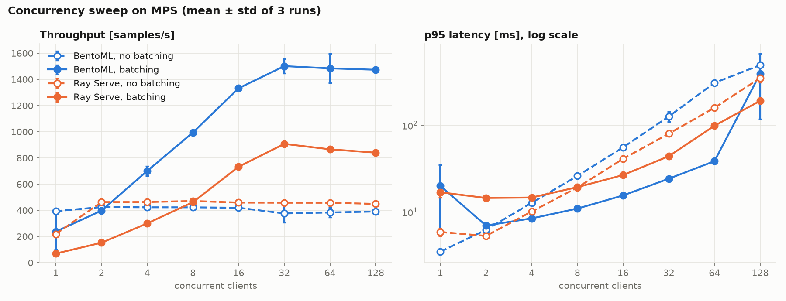
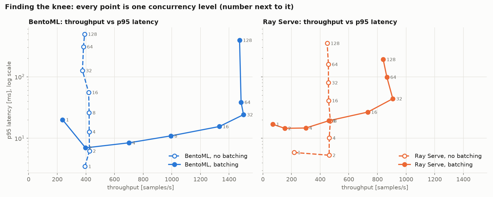
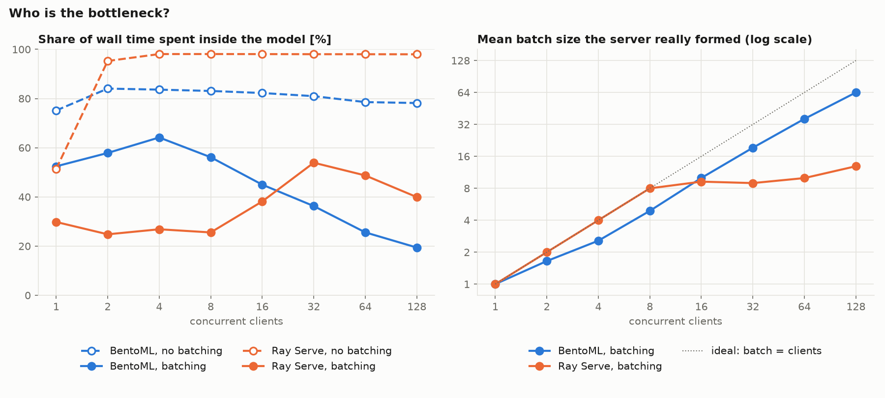

# Lab 2 (HW2): serwowanie modelu jako API + benchmark dynamicznego batchowania

Polecenie: [`homeworks/HOMEWORK2.MD`](../homeworks/HOMEWORK2.MD) · English version: [README.en.md](README.en.md)

Model z HW1 (klasyfikator CIFAR-10, mały ResNet, `models/lab1/best`, 90,73% dokładności na zbiorze testowym)
jest wystawiony jako REST API w **dwóch** narzędziach i zmierzony z batchowaniem i bez:

| Narzędzie | Batchowanie | Gdzie jest skonfigurowane |
|---|---|---|
| **BentoML 1.4.40** | adaptacyjne (`batchable=True`, `max_batch_size`, `max_latency_ms`) | [`service.py`](service.py) |
| **Ray Serve 2.60.0** | dynamiczne ze stałym oknem (`@serve.batch`, `max_batch_size`, `batch_wait_timeout_s`) | [`ray_app.py`](ray_app.py) |

Wyniki: [`results/results.md`](results/results.md) (tabele) i wykresy w [`results/`](results/).

## Prezentacja (5 min): plan i co mówimy

| # | Punkt | Czas | Gdzie w tym pliku |
|---|---|---|---|
| 1 | Model i zadanie, narzędzia i dlaczego | 0:30 | niżej + [Dlaczego…](#dlaczego-best-mps-i-te-dwa-narzędzia) |
| 2 | Kod: gdzie jest batchowanie | 0:30 | niżej |
| 3 | Żądanie na żywo | 0:30 | niżej + [Przykładowe żądanie](#przykładowe-żądanie-na-żywo) |
| 4 | Pytanie do sali, potem tabela porównawcza | 0:45 | [Cztery konfiguracje obok siebie](#cztery-konfiguracje-obok-siebie) |
| 5 | Kolano | 0:30 | [Kolano](#kolano-współbieżność-1128) |
| 6 | Wąskie gardło | 0:45 | [Kto jest wąskim gardłem?](#kto-jest-wąskim-gardłem) |
| 7 | Dynamiczne vs adaptacyjne + histereza | 0:45 | [Batchowanie dynamiczne vs adaptacyjne](#batchowanie-dynamiczne-ray-serve-vs-adaptacyjne-bentoml) |
| 8 | Rekomendacja produkcyjna | 0:20 | [Rekomendacja produkcyjna](#rekomendacja-produkcyjna) |
| 9 | Problemy + wniosek w jednym zdaniu | 0:25 | [Problemy](#problemy-które-warto-znać) + niżej |

**1. Model i zadanie (przypomnienie z HW1).** Klasyfikacja obrazów CIFAR-10: 10 klas, kolorowe obrazki 32×32. Model to
mały ResNet w PyTorch Lightning, z hiperparametrami dobranymi przez Optunę (`models/lab1/best`). Ma 692 tys. parametrów
i 90,73% dokładności na zbiorze testowym. Do serwowania eksportujemy go do TorchScript (`export_model.py`), z
normalizacją i softmaxem w środku, więc serwer dostaje surowe bajty obrazka. Dokładność po eksporcie jest taka sama.
Narzędzia: **BentoML** (batchowanie adaptacyjne) i **Ray Serve** (dynamiczne ze stałym oknem). Wybrałem je, bo
dobrze pokazują różnicę między tymi dwoma rodzajami batchowania, a oba działają natywnie na Macu z GPU (MPS).
Triton na Macu działa tylko w Dockerze, bez GPU.

**2. Gdzie jest batchowanie w kodzie.** Model i kod wspólny (`common.py`) są takie same dla obu narzędzi; różni je
tylko ten fragment.

BentoML ([`service.py`](service.py)): jeden dekorator; dyspozytor sam składa żądania w paczkę.

```python
batching_options = (
    {"batchable": True, "batch_dim": 0, "max_batch_size": MAX_BATCH_SIZE, "max_latency_ms": MAX_LATENCY_MS}
    if BATCHING
    else {"batchable": False}
)

@bentoml.api(**batching_options)
def predict(self, images: list[str]) -> list[dict]:
    # with batching on, `images` is the concatenation of the lists of many requests
    return self.runner.predict(images)
```

Ray Serve ([`ray_app.py`](ray_app.py)): `@serve.batch` daje listę żądań, a podział wyników z powrotem robimy sami.

```python
@serve.batch(max_batch_size=MAX_BATCH_SIZE, batch_wait_timeout_s=BATCH_WAIT_MS / 1000)
async def _predict_batched(self, requests: list[list[str]]) -> list[list[dict]]:
    flat = [image for images in requests for image in images]
    predictions = await self._run(flat)
    ...  # split predictions back, one list per request
```

Parametry: `max_batch_size=64` w obu; BentoML `max_latency_ms=1000` (to budżet opóźnienia, nie okno); Ray Serve
okno 5 ms.

**3. Żądanie na żywo** (przed prezentacją uruchom serwer w osobnym terminalu):

```bash
cd lab2 && source .venv/bin/activate
BATCHING=1 bentoml serve service:CifarClassifier --port 3111          # terminal 1, start ~10 s

curl -s -X POST http://127.0.0.1:3111/predict \
     -H 'content-type: application/json' -d @sample_request.json      # terminal 2
# [{"label": "cat", "class_id": 3, "confidence": 0.9572}]
python client_example.py                                              # 8 obrazków ze zbioru testowego
```

**4. Pytanie do sali przed pokazaniem tabeli:** „Które narzędzie wygrało i ile dało batchowanie: 1,5×, 3× czy 10×?".
Odpowiedź: BentoML; batchowanie dało 3,5× w BentoML i 1,9× w Ray Serve. Sam model na GPU dałby ~20× (paczka 64 vs 1),
ale resztę zjada narzut HTTP i Pythona (punkt 6).

**9. Wniosek w jednym zdaniu:** *Zanim włączysz batchowanie, zmierz, gdzie idzie czas. U nas batchowanie dało 3,5×,
bo koszt modelu na GPU jest prawie stały na wywołanie. Dalej ogranicza już proces Pythona obsługujący HTTP, nie GPU.
Kolejny krok to więcej replik, a nie większe paczki.*

## Dlaczego `best`, MPS i te dwa narzędzia

* **Model `best`** ma najwyższą dokładność z trzech modeli HW1 (90,7% vs 85,5% i 77,9%) i jest największy (692 tys. parametrów),
  więc batchowanie ma najwięcej do zyskania na tle narzutu HTTP.
* **Urządzenie: GPU Apple Silicon (MPS).** Sam model (bez HTTP) na MPS: 1 obrazek ≈ 2,4 ms, paczka 64 ≈ 6,7 ms,
  czyli przepustowość rośnie z ok. 420 do ok. 9 500 próbek/s. Na CPU batchowanie daje najwyżej ok. 1,5×.
  Na CPU zrobiony jest krótszy pomiar kontrolny.
* **BentoML** ma prawdziwie *adaptacyjne* batchowanie, o które prosi polecenie. **Ray Serve** ma klasyczne *dynamiczne*
  batchowanie ze stałym oknem, więc dobrze pokazuje różnicę. Oba działają natywnie na macOS z dostępem do MPS.
  Triton działałby na Macu tylko w Dockerze, a kontener na macOS nie ma dostępu do GPU.

## Struktura

```
lab2/
├── export_model.py        # checkpoint Lightning -> TorchScript (models/lab2/model.pt) + kontrola dokładności
├── common.py              # wspólny kod obu serwerów: ładowanie modelu, dekodowanie wejścia, inferencja, statystyki
├── service.py             # serwis BentoML (port 3111)
├── ray_app.py             # aplikacja Ray Serve
├── ray_serve.yaml         # konfiguracja Ray Serve (port 8111, bez logów dostępu)
├── client_example.py      # przykładowy klient (requests)
├── sample_request.json    # gotowe żądanie dla cURL (1 obrazek, prawdziwa klasa: cat)
├── benchmark/
│   ├── loadtest.py        # jeden pomiar: N współbieżnych klientów, rozgrzewka + okno 60 s
│   ├── run_benchmark.py   # cały benchmark: narzędzia × batchowanie × współbieżność × powtórzenia
│   ├── hysteresis.py      # czy adaptacyjne batchowanie pamięta przeszły ruch? (1 klient przed/po fali)
│   ├── find_bottleneck.py # wykorzystanie GPU pod obciążeniem + koszt każdego kroku żądania
│   └── make_report.py     # tabele (results/results.md) i wykresy (results/*.png)
└── results/
    ├── raw.jsonl          # surowe wyniki (1 linia = 1 pomiar), MPS
    ├── raw_cpu.jsonl      # pomiar kontrolny na CPU
    ├── hysteresis.jsonl, bottleneck.json
    ├── results.md         # tabele
    ├── sweep.png, knee.png, bottleneck.png
    └── invalid_run1/, invalid_run2_*/   # odrzucone pomiary (patrz „Problemy")
```

Wyeksportowany model trafia do `models/lab2/` (`model.pt`, `model_info.json`, przykładowe obrazki testowe).

## Środowisko

Python 3.12, osobne środowisko jak w lab1:

```bash
cd lab2
uv python install 3.12
uv venv --python 3.12 .venv
source .venv/bin/activate
uv pip install -r requirements.txt
touch .venv/.metadata_never_index   # macOS: Spotlight indeksujący świeże .venv zjada kilka rdzeni
```

## Uruchomienie

```bash
python export_model.py      # raz: models/lab1/best/best.ckpt -> models/lab2/model.pt

# BentoML (http://127.0.0.1:3111)
BATCHING=1 bentoml serve service:CifarClassifier --port 3111   # z adaptacyjnym batchowaniem
BATCHING=0 bentoml serve service:CifarClassifier --port 3111   # bez batchowania

# Ray Serve (http://127.0.0.1:8111)
BATCHING=1 serve run ray_serve.yaml   # z dynamicznym batchowaniem
BATCHING=0 serve run ray_serve.yaml   # bez batchowania
```

Porty 3111/8111 zamiast domyślnych 3000/8000, bo te bywają zajęte (u mnie przez kontenery Dockera).

Zmienne środowiskowe (czyta je `common.py`, `service.py` i `ray_app.py`):

| Zmienna | Domyślnie | Znaczenie |
|---|---|---|
| `BATCHING` | `1` | `1` = batchowanie włączone, `0` = wyłączone |
| `DEVICE` | `mps` (jeśli jest) | `mps`, `cpu` albo `cuda` |
| `MAX_BATCH_SIZE` | `64` | maksymalna wielkość paczki (oba narzędzia) |
| `MAX_LATENCY_MS` | `1000` | BentoML: budżet opóźnienia żądania |
| `BATCH_WAIT_MS` | `5` | Ray Serve: stałe okno czekania na paczkę |
| `TORCH_THREADS` | `4` | wątki PyTorch na CPU |

## API i przykładowe żądanie

`POST /predict` przyjmuje JSON `{"images": [...]}`, gdzie każdy obrazek to base64 z 3 072 surowych bajtów
(32×32×3, RGB, `uint8`). Zwraca jedną predykcję na obrazek. Normalizacja i softmax są wbudowane w wyeksportowany model.

```bash
curl -s -X POST http://127.0.0.1:3111/predict \
     -H 'content-type: application/json' -d @sample_request.json
```

```json
[{"label": "cat", "class_id": 3, "confidence": 0.9572}]
```

Klient w Pythonie (8 obrazków ze zbioru testowego):

```bash
python client_example.py                              # BentoML
python client_example.py --url http://127.0.0.1:8111  # Ray Serve
```

Dodatkowo oba serwery mają `POST /stats` (histogram wielkości paczek, które batcher naprawdę utworzył, i czas
spędzony w modelu) oraz `POST /reset_stats`.

## Benchmark

```bash
python benchmark/run_benchmark.py      # pełny przebieg (~2 h): 2 narzędzia × 2 tryby × 8 poziomów × 3 powtórzenia
python benchmark/run_benchmark.py --tools bentoml --device cpu --concurrency 1 8 32 --tag cpu --out results/raw_cpu.jsonl
python benchmark/hysteresis.py         # histereza batchowania (BentoML; --tool ray jako kontrola)
python benchmark/find_bottleneck.py    # wykorzystanie GPU + koszt kroków żądania
python benchmark/make_report.py        # tabele i wykresy
python benchmark/loadtest.py --url http://127.0.0.1:3111 --concurrency 32   # pojedynczy pomiar na działającym serwerze
```

Metodologia (zgodnie z poleceniem):

* **Przepustowość** w próbkach/s w stałym oknie **60 s**; 1 żądanie = 1 obrazek, więc żądania/s = próbki/s.
* **Opóźnienia** p50/p95/p99 mierzone po stronie klienta.
* **Rozgrzewka 15 s** odrzucana przed każdym pomiarem; serwer dodatkowo rozgrzewa model przy starcie.
* **Współbieżność** 1, 2, 4, 8, 16, 32, 64, 128 klientów w pętli zamkniętej (każdy wysyła następne żądanie po odebraniu odpowiedzi).
* **3 powtórzenia**, wynik to średnia ± odchylenie standardowe. Powtórzenia są pętlą zewnętrzną, więc powolne zmiany
  stanu maszyny rozkładają się na wszystkie poziomy.
* **Te same warunki** dla wszystkich konfiguracji: ten sam model, ten sam obrazek, 1 replika/1 worker, ten sam komputer
  dla klienta i serwera. Każdy pomiar zapisuje źródło zasilania i tryb niskiego poboru energii; benchmark odmawia startu na baterii.
* **Klient nie jest wąskim gardłem:** klienci są rozłożeni na maks. 4 procesy (asyncio + aiohttp); zapisywane jest zużycie
  CPU najbardziej obciążonego procesu klienta (ok. 5% jednego rdzenia).
* Dla analizy wąskiego gardła każdy pomiar zapisuje też: rzeczywiste wielkości paczek, udział czasu w modelu
  i zużycie CPU każdego procesu serwera (psutil).

Sprzęt: **Apple M3 Pro** (11 rdzeni CPU, 18 GB RAM, GPU przez MPS), macOS 26 (Darwin 25.5), PyTorch 2.5.1.
Klient i serwer na tym samym komputerze.

Parametry batchowania: `max_batch_size=64` (oba), BentoML `max_latency_ms=1000`, Ray Serve `batch_wait_timeout_s=0.005`.

## Wyniki

Pełne tabele (wszystkie poziomy, średnia ± odch. std., p50/p95/p99, rozmiary paczek, CPU): [`results/results.md`](results/results.md).
Warunki: MPS, okno 60 s po 15 s rozgrzewki, 3 powtórzenia, 96/96 pomiarów na zasilaczu, 0 nieudanych żądań.

### Cztery konfiguracje obok siebie

| Współbieżność | BentoML, bez batchowania | BentoML, batchowanie adaptacyjne | Ray Serve, bez batchowania | Ray Serve, batchowanie dynamiczne |
|---|---|---|---|---|
| 1 | **393 próbek/s**, p95 3,5 ms | 237 próbek/s, p95 20,0 ms ¹ | 219 próbek/s, p95 5,9 ms | 70 próbek/s, p95 16,9 ms |
| 2 | 425 próbek/s, p95 6,2 ms | 398 próbek/s, p95 7,0 ms | **463 próbek/s**, p95 5,3 ms | 153 próbek/s, p95 14,5 ms |
| 8 | 423 próbek/s, p95 26,0 ms | **994 próbek/s**, p95 10,9 ms | 471 próbek/s, p95 19,2 ms | 462 próbek/s, p95 19,3 ms |
| 32 | 376 próbek/s, p95 126 ms | **1501 próbek/s**, p95 24,2 ms | 458 próbek/s, p95 80,0 ms | 907 próbek/s, p95 44,0 ms |
| 128 | 391 próbek/s, p95 494 ms | **1473 próbek/s**, p95 393 ms | 449 próbek/s, p95 350 ms | 840 próbek/s, p95 191 ms |

p50/p95/p99 [ms] na wybranych poziomach:

| Konfiguracja | c=1 | c=8 | c=32 | c=128 |
|---|---|---|---|---|
| BentoML, bez batchowania | 2,4 / 3,5 / 6,1 | 17,8 / 26,0 / 38,1 | 82,7 / 126 / 258 | 288 / 494 / 572 |
| BentoML, batchowanie | 2,4 / 20,0 / 33,1 ¹ | 7,9 / 10,9 / 11,7 | 18,4 / 24,2 / 27,7 | 59,4 / 393 / 605 |
| Ray Serve, bez batchowania | 4,4 / 5,9 / 7,3 | 16,6 / 19,2 / 21,9 | 67,8 / 80,0 / 88,4 | 275 / 350 / 394 |
| Ray Serve, batchowanie | 14,2 / 16,9 / 18,2 | 17,3 / 19,3 / 20,8 | 35,3 / 44,0 / 48,5 | 156 / 191 / 210 |

¹ Duży rozrzut to nie szum: powtórzenie 1 (świeży serwer) dało 392 próbek/s i p95 3,2 ms, a powtórzenia 2 i 3 szły zaraz
po pomiarze ze 128 klientami z poprzedniego powtórzenia i dały 145 i 175. To „pamięć" batchowania adaptacyjnego, patrz niżej.

**Przyspieszenie z batchowania** (najlepsza przepustowość z vs bez): BentoML **3,5×** (1501 vs 425), Ray Serve **1,9×** (907 vs 471).
Przy c=32 BentoML z batchowaniem ma 4× większą przepustowość *i* 5× niższe p95 niż bez batchowania: bez batchowania
żądania po prostu stoją w kolejce.



### Kolano (współbieżność 1–128)



* **Bez batchowania (oba narzędzia):** kolano już przy **c=2**. Model liczy jedno wywołanie naraz, więc przepustowość
  staje na ~420–470 próbek/s, a każdy kolejny klient dokłada tylko kolejkę: opóźnienie rośnie liniowo z liczbą klientów
  (prawo Little'a: p50 ≈ c / przepustowość, np. 128 / 391 ≈ 327 ms vs 288 ms zmierzone).
* **BentoML z batchowaniem:** przepustowość rośnie do **c=32** (1501 próbek/s, p95 24 ms), potem stoi. Przy c=64 p95 to
  jeszcze 38 ms, ale p99 skacze do 534 ms, a przy c=128 p95 to 393 ms. **Kolano: c≈32.** Dalej dokładamy już tylko opóźnienie.
* **Ray Serve z batchowaniem:** kolano też przy **c=32** (907 próbek/s, p95 44 ms); dalej przepustowość nawet lekko spada
  (840 przy c=128), a opóźnienie podwaja się z każdym podwojeniem liczby klientów.

### Kto jest wąskim gardłem?



Zmierzone przez [`benchmark/find_bottleneck.py`](benchmark/find_bottleneck.py) (okna 30 s; wykorzystanie GPU z `ioreg`):

| Konfiguracja, 32 klientów | Przepustowość | Wykorzyst. GPU | Czas w modelu | Średnia paczka | CPU serwera [rdzenie] |
|---|---|---|---|---|---|
| BentoML, bez batchowania | 451 próbek/s | 61% | 84% | 1 | worker 0,94 |
| BentoML, batchowanie | 1607 próbek/s | 36% | 38% | 19,8 | worker 0,77 |
| Ray Serve, bez batchowania | 465 próbek/s | 59% | 98% | 1 | replika 1,48, proxy 0,78 |
| Ray Serve, batchowanie | 899 próbek/s | 41% | 53% | 9,1 | replika 1,62, **proxy 1,53** |

Koszt jednego żądania zmierzony w procesie, bez HTTP: parsowanie JSON 0,004 ms, dekodowanie base64 0,006 ms, model
przy paczce 1 **1,90 ms**, przy paczce 64 **6,41 ms (0,10 ms na obrazek)**.

* **Bez batchowania ogranicza koszt jednego wywołania modelu, a nie moc GPU.** MPS ma stały koszt wywołania
  (uruchomienie kerneli, kopiowanie, synchronizacja) ok. 1,9 ms, a sam obrazek kosztuje prawie nic (0,1 ms w paczce 64).
  Wywołania idą jedno po drugim, więc sufit to 1 / 2,1 ms ≈ 470 próbek/s. Ray Serve dochodzi do niego dokładnie (98% czasu
  w modelu); BentoML staje na ~425–450, bo obsługa HTTP przeplata się z modelem w tym samym procesie (84% w modelu).
* **BentoML z batchowaniem: ogranicza go jego jeden proces Pythona.** Model zajmuje tylko 38% czasu, a GPU jest zajęte w
  36%, *mniej* niż bez batchowania, przy 3,5× większej przepustowości. Resztę czasu zjada framework: HTTP, walidacja
  wejścia, dyspozytor i asyncio, ok. 0,4 ms Pythona na żądanie. Nasze własne dekodowanie (JSON + base64) to z tego tylko
  0,01 ms. Ani GPU, ani CPU nie są nasycone (worker zużywa 0,77 rdzenia). Ogranicza szeregowe przeplatanie pracy HTTP
  i wywołań modelu w jednym procesie (GIL). Dlatego skalowanie to więcej workerów/replik.
* **Ray Serve z batchowaniem: ogranicza proxy HTTP.** Każde żądanie idzie HTTP → proxy → RPC → replika, a proxy zużywa
  1,5 rdzenia przy 899 próbkach/s. Żądania docierają do repliki zbyt wolno, by zapełnić duże paczki, więc średnia paczka
  staje na ~9–13 nawet przy 128 klientach (prawy wykres wyżej). Stąd 1,9× zamiast 3,5× w BentoML.
* **Klient nie jest wąskim gardłem:** najbardziej obciążony proces klienta zużywa ≤ 5% jednego rdzenia (kolumna w `results.md`).

### Batchowanie dynamiczne (Ray Serve) vs adaptacyjne (BentoML)

* **Ray Serve, `@serve.batch`: stałe okno.** Pierwsze żądanie w kolejce uruchamia zegar. Paczka wychodzi, gdy ma
  `max_batch_size` żądań albo po `batch_wait_timeout_s` (5 ms), cokolwiek nastąpi pierwsze. Reguła nie patrzy na ruch, więc
  **przy małym ruchu każde żądanie płaci okno**: przy 1 kliencie p50 to 14,2 ms vs 4,4 ms bez batchowania (ok. 10 ms
  więcej, dwa razy tyle co same 5 ms okna; tego narzutu nie rozkładaliśmy dalej). Opłaca się dopiero od c≥16. Jego zaletą jest
  **przewidywalność**: zachowuje się tak samo niezależnie od tego, co działo się wcześniej (niżej).
* **BentoML, `CorkDispatcher`: adaptacyjne.** Na podstawie ostatnich 50 paczek dyspozytor dopasowuje liniowy model czasu
  paczki `t(n) = a·n + b` (metodą najmniejszych kwadratów) i pamięta średni czas, jaki żądania czekały przed wysłaniem.
  Trzyma kolejkę tylko wtedy, gdy czekanie się opłaca (`n·(wn + dt + a) ≤ 0,95·średnie_czekanie`), a najstarsze żądanie
  mieści się w `max_latency_ms`; inaczej anuluje żądania (503). Żądania nie są więc trzymane dłużej, niż trzeba. Przy 1
  kliencie na świeżym serwerze uczy się, że w ogóle nie warto czekać, i ma opóźnienie jak bez batchowania (p95 2,6–3,2 ms).
  Pod obciążeniem sam tworzy duże paczki (średnio 19 przy c=32, 64 przy c=128), bez okna do strojenia.
  Źródło: `bentoml/_internal/marshal/dispatcher.py`.
* **Ceną adaptacyjności jest pamięć (histereza)**, zmierzona w [`benchmark/hysteresis.py`](benchmark/hysteresis.py)
  (jeden serwer, okna 30 s, rozgrzewka 3 s, wyniki w `results/hysteresis.jsonl`):

| Etap | BentoML (adaptacyjne) | Ray Serve (stałe okno 5 ms) |
|---|---|---|
| 1 klient, świeży serwer | 399 próbek/s, p95 2,6 ms | 83 próbek/s, p95 13,3 ms |
| 128 klientów | 1745 próbek/s, średnia paczka 64 | 790 próbek/s, średnia paczka 12 |
| 1 klient, zaraz potem | **23 próbek/s**, p95 67 ms | 86 próbek/s, p95 13,0 ms |
| 1 klient, 30 s później | 158 próbek/s, p95 19,5 ms | 84 próbek/s |
| znów 128 klientów, potem 1 klient | 31 próbek/s, p95 52 ms | 82 próbek/s |
| 1 klient, po restarcie serwera | 414 próbek/s, p95 2,6 ms | 83 próbek/s |

  Po dużym ruchu zapamiętane przez dyspozytora BentoML średnie czekanie wynosi dziesiątki milisekund, więc trzyma on
  nawet pojedyncze żądanie, „aż paczka się zapełni". Czas czekania tego żądania trafia do tej samej średniej, więc
  stan sam się podtrzymuje i wygasa powoli (współczynnik 0,95). Przepustowość przy 1 kliencie spada 17×. Ray Serve tego nie ma: za każdym razem 82–86 próbek/s.

### Pomiar kontrolny na CPU (BentoML, `results/raw_cpu.jsonl`)

| Współbieżność | CPU, bez batchowania | CPU, batchowanie | MPS, batchowanie |
|---|---|---|---|
| 1 | **818 próbek/s**, p95 1,3 ms | 481 ± 303 próbek/s ¹ | 237 próbek/s |
| 8 | 958 próbek/s, p95 8,6 ms | 1078 próbek/s, p95 9,2 ms | 994 próbek/s |
| 32 | 915 próbek/s, p95 35 ms | 1183 próbek/s, p95 28 ms | **1501 próbek/s** |

Na CPU batchowanie daje tylko 1,3×: czas modelu rośnie prawie liniowo z rozmiarem paczki (paczka 32 ≈ 44 ms, ~1,4 ms na
obrazek), więc nie ma czego współdzielić. Amortyzuje się tylko narzut HTTP, a serwer zużywa ~4 rdzenie. Dla pojedynczego
obrazka CPU jest wręcz szybszy od GPU (1,2 vs 2,4 ms, bez kosztu uruchamiania kerneli MPS i synchronizacji). GPU wygrywa
dopiero wtedy, gdy batchowanie daje mu duże paczki: najlepszy wynik ogółem to MPS + batchowanie, a CPU zajmuje się wtedy tylko HTTP.

### Rekomendacja produkcyjna

**BentoML z batchowaniem adaptacyjnym na GPU**, pod warunkiem że:

1. **Obniżymy `max_latency_ms`** z 1000 do ok. **50–100 ms** (≈ 2–4 × p95 przy kolanie). Przy 1000 ms ogon przeciążenia przy
   c=128 to p99 ≈ 600 ms; przy ciasnym budżecie serwer szybko odpowiada 503, a load balancer może ponowić żądanie na innej replice.
2. **Skalujemy wszerz zamiast podnosić współbieżność:** jedna replika nasyca się na ~1500 próbek/s przy c≈32, a ogranicza
   ją jej jeden proces Pythona, nie GPU. Więcej przepustowości to więcej `workers`/replik.
3. **Pamiętamy o histerezie:** przy ruchu, który przeplata fale z ciszą, opóźnienie pojedynczego żądania po fali może
   wzrosnąć ponad 10×. Jeśli krytyczne jest p95 przy małym ruchu, lepszy będzie Ray Serve z krótkim oknem (przewidywalny)
   albo brak batchowania (przy c ≤ 2 to najszybsza opcja).

### Przykładowe żądanie (na żywo)

```bash
python client_example.py
```

```
ok  predicted cat        p=0.957   true: cat
ok  predicted ship       p=0.966   true: ship
ok  predicted ship       p=0.954   true: ship
ok  predicted airplane   p=0.728   true: airplane
ok  predicted frog       p=0.924   true: frog
ok  predicted frog       p=0.843   true: frog
ok  predicted automobile p=0.644   true: automobile
ok  predicted frog       p=0.819   true: frog
```

### Co naprawdę zrobił batcher? (`/stats`, histogram rozmiarów paczek)

| Konfiguracja | Najczęstsze rozmiary paczek (udział w paczkach) |
|---|---|
| BentoML, 8 klientów | 1 (39%), 7 (39%), 8 (22%) |
| BentoML, 32 klientów | 25 (50%), 7 (50%) |
| BentoML, 128 klientów | 64 (100%) |
| Ray Serve, 8 klientów | 8 (100%) |
| Ray Serve, 32 klientów | 3–7 (rozrzut, średnio 9) |
| Ray Serve, 128 klientów | najczęściej 1–5 (średnio 13) |

BentoML wysyła naraz tylko jedną paczkę, więc klienci dzielą się na dwie grupy, które się zmieniają: gdy jedna paczka jest
w modelu, żądania drugiej grupy zbierają się w następną (25 + 7 = 32). Przy 128 klientach każda paczka jest pełna (64).
W Ray Serve przy 8 klientach okno 5 ms zawsze zbiera wszystkie 8. Przy większej liczbie klientów paczki są małe i
nierówne, bo żądania sączą się przez proxy (patrz sekcja o wąskim gardle).

## Problemy, które warto znać

* **NNPACK na Apple Silicon:** PyTorch dla paczek ≥ 16 na CPU wybiera konwolucje NNPACK, które na M3 są ok. 10× wolniejsze
  (paczka 32: 110 ms zamiast 44 ms). Wyłączone przez `torch.backends.nnpack.set_flags(False)` w `common.py`.
* **TorchScript na MPS:** `torch.jit.load(..., map_location="mps")` kończy się błędem (w grafie jest stała float64,
  której MPS nie obsługuje). Trzeba wczytać na CPU i dopiero przenieść: `.to("mps")`.
* **Klient potrafi być wąskim gardłem:** jednoprocesowy klient `httpx` dawał ok. 2,5× mniej żądań/s niż `aiohttp`
  rozłożony na kilka procesów, na tym samym serwerze.
* **Pierwszy pełny przebieg był bezwartościowy** ([`results/invalid_run1/`](results/invalid_run1/)): laptop był na baterii,
  zasnął po zamknięciu klapy (`caffeinate` tego nie blokuje na baterii), a pod koniec włączył się tryb niskiego
  poboru energii. Stąd zapis stanu zasilania przy każdym pomiarze.
* **Drugi przebieg, częściowo powtórzony:** ładowarka kilka razy się rozłączała, a macOS sam włączał tryb niskiego
  poboru energii. Benchmark czeka teraz na zasilacz przed każdym oknem i powtarza okno, w którym zasilanie się zmieniło
  (odłożone w [`results/invalid_run2_power/`](results/invalid_run2_power/)).
* **Uczciwe porównanie wymaga tego samego tła:** część BentoML szła przy 3 kontenerach Dockera w tle, pierwsza część
  Ray Serve przy 14, a ta sama konfiguracja była wtedy ok. 30% wolniejsza. Dlatego wszystkie pomiary Ray Serve i CPU bez
  batchowania powtórzono przy 3 kontenerach; stare są w
  [`results/invalid_run2_conditions/`](results/invalid_run2_conditions/). Warunki końcowe: zasilacz, 3 bezczynne kontenery Dockera.
* **Histereza adaptacyjnego batchowania** sprawia, że kolejność pomiarów ma znaczenie (patrz „Dynamiczne vs adaptacyjne").
  Pokazujemy ją, a nie ukrywamy: w głównej tabeli widać ją jako duży rozrzut przy c=1.
* **Procesy `spawn` czytają skrypt główny od nowa:** klienci działają w `multiprocessing` ze `spawn`, więc pliku skryptu
  nie wolno zmieniać ani przemianowywać w trakcie benchmarku. (`benchmark/bottleneck.py` przemianowano na
  `find_bottleneck.py`, bo przesłaniał pakiet `bottleneck`, który importuje pandas.)
* **Logi dostępu** (jedna linia na żądanie) są wyłączone w obu serwerach, bo przy tysiącach żądań/s są częścią mierzonego narzutu.
* Domyślne porty 3000/8000 bywają zajęte; tutaj 3111/8111.
