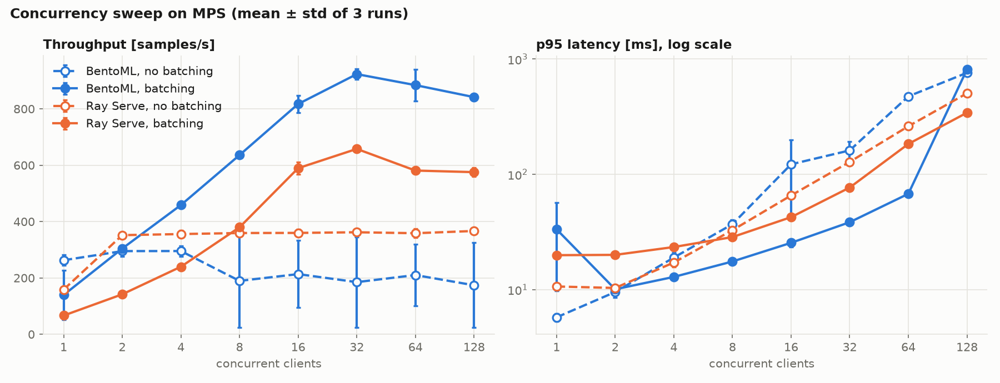
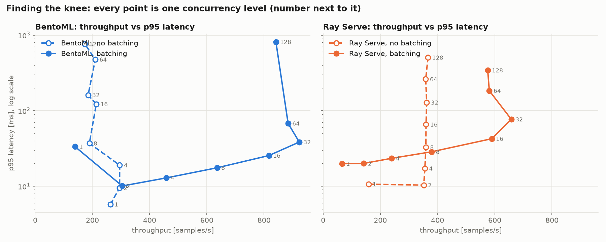
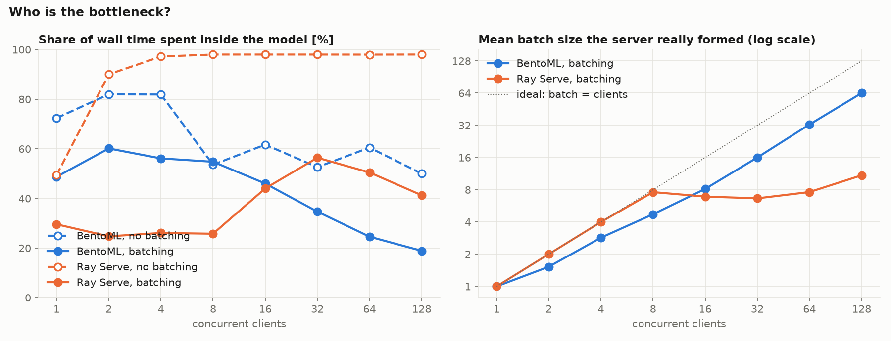

# Benchmark results

Generated by `benchmark/make_report.py` from `results/raw*.jsonl`.

Device: **MPS**, window 60 s after 15 s warm-up, 3 repeats per point (mean ± std), 1 image per request. `max_batch_size=64`; BentoML `max_latency_ms=1000`; Ray Serve `batch_wait_timeout_s=0.005`.

## BentoML: without vs with dynamic batching

| Concurrency | Throughput no batching [samples/s] | Throughput with batching [samples/s] | Speed-up | p95 latency no batching [ms] | p95 latency with batching [ms] |
|---|---|---|---|---|---|
| 1 | 263 ± 18 | 140 ± 88 | 0.53× | 5.8 ± 0.5 | 33.4 ± 23.7 |
| 2 | 295 ± 20 | 304 ± 10 | 1.03× | 9.5 ± 1.0 | 10.1 ± 0.8 |
| 4 | 295 ± 19 | 459 ± 2 | 1.55× | 19.0 ± 2.0 | 12.9 ± 0.0 |
| 8 | 190 ± 165 | 636 ± 9 | 3.35× | 37.0 ± 3.2 | 17.6 ± 0.3 |
| 16 | 214 ± 119 | 817 ± 30 | 3.83× | 122.3 ± 77.7 | 25.5 ± 1.9 |
| 32 | 185 ± 161 | 923 ± 19 | 4.99× | 161.4 ± 31.3 | 38.5 ± 0.6 |
| 64 | 210 ± 109 | 884 ± 56 | 4.21× | 475.2 ± 19.9 | 67.8 ± 2.3 |
| 128 | 174 ± 151 | 842 ± 12 | 4.84× | 760.8 ± 2.0 | 814.2 ± 16.4 |

## Ray Serve: without vs with dynamic batching

| Concurrency | Throughput no batching [samples/s] | Throughput with batching [samples/s] | Speed-up | p95 latency no batching [ms] | p95 latency with batching [ms] |
|---|---|---|---|---|---|
| 1 | 159 ± 5 | 66 ± 1 | 0.42× | 10.7 ± 0.6 | 19.9 ± 0.7 |
| 2 | 352 ± 7 | 142 ± 3 | 0.40× | 10.3 ± 0.3 | 20.0 ± 1.1 |
| 4 | 356 ± 13 | 240 ± 3 | 0.67× | 17.2 ± 1.4 | 23.4 ± 0.6 |
| 8 | 359 ± 11 | 380 ± 5 | 1.06× | 32.8 ± 1.1 | 28.6 ± 0.8 |
| 16 | 360 ± 13 | 590 ± 22 | 1.64× | 65.6 ± 3.8 | 42.6 ± 2.7 |
| 32 | 362 ± 7 | 658 ± 7 | 1.82× | 128.4 ± 2.3 | 76.9 ± 1.0 |
| 64 | 359 ± 16 | 581 ± 11 | 1.62× | 261.5 ± 13.6 | 183.6 ± 11.5 |
| 128 | 367 ± 7 | 575 ± 16 | 1.57× | 505.2 ± 8.0 | 342.8 ± 19.3 |

## Tool comparison

| Concurrency | BentoML, no batching | BentoML, batching | Ray Serve, no batching | Ray Serve, batching |
|---|---|---|---|---|
| 1 | 263 samples/s, p95 5.8 ms | 140 samples/s, p95 33.4 ms | 159 samples/s, p95 10.7 ms | 66 samples/s, p95 19.9 ms |
| 2 | 295 samples/s, p95 9.5 ms | 304 samples/s, p95 10.1 ms | 352 samples/s, p95 10.3 ms | 142 samples/s, p95 20.0 ms |
| 4 | 295 samples/s, p95 19.0 ms | 459 samples/s, p95 12.9 ms | 356 samples/s, p95 17.2 ms | 240 samples/s, p95 23.4 ms |
| 8 | 190 samples/s, p95 37.0 ms | 636 samples/s, p95 17.6 ms | 359 samples/s, p95 32.8 ms | 380 samples/s, p95 28.6 ms |
| 16 | 214 samples/s, p95 122.3 ms | 817 samples/s, p95 25.5 ms | 360 samples/s, p95 65.6 ms | 590 samples/s, p95 42.6 ms |
| 32 | 185 samples/s, p95 161.4 ms | 923 samples/s, p95 38.5 ms | 362 samples/s, p95 128.4 ms | 658 samples/s, p95 76.9 ms |
| 64 | 210 samples/s, p95 475.2 ms | 884 samples/s, p95 67.8 ms | 359 samples/s, p95 261.5 ms | 581 samples/s, p95 183.6 ms |
| 128 | 174 samples/s, p95 760.8 ms | 842 samples/s, p95 814.2 ms | 367 samples/s, p95 505.2 ms | 575 samples/s, p95 342.8 ms |

## All measurements

| Tool | Batching | Concurrency | Throughput [samples/s] | p50 [ms] | p95 [ms] | p99 [ms] | Mean batch | Time in model | Server CPU [cores] | Busiest client process | Failed requests |
|---|---|---|---|---|---|---|---|---|---|---|---|
| BentoML | no | 1 | 263 ± 18 | 3.4 | 5.8 | 8.0 | 1.0 | 72% | 0.84 | 6% of a core | 0.00% |
| BentoML | no | 2 | 295 ± 20 | 6.4 | 9.5 | 13.1 | 1.0 | 82% | 0.97 | 5% of a core | 0.00% |
| BentoML | no | 4 | 295 ± 19 | 12.7 | 19.0 | 26.2 | 1.0 | 82% | 0.97 | 3% of a core | 0.00% |
| BentoML | no | 8 | 190 ± 165 | 26.8 | 37.0 | 45.8 | 0.7 | 54% | 0.66 | 3% of a core | 0.00% |
| BentoML | no | 16 | 214 ± 119 | 51.0 | 122.3 | 144.7 | 1.0 | 62% | 0.76 | 3% of a core | 0.00% |
| BentoML | no | 32 | 185 ± 161 | 105.8 | 161.4 | 357.8 | 0.7 | 53% | 0.66 | 3% of a core | 0.00% |
| BentoML | no | 64 | 210 ± 109 | 205.7 | 475.2 | 547.3 | 1.0 | 61% | 0.76 | 3% of a core | 0.00% |
| BentoML | no | 128 | 174 ± 151 | 432.9 | 760.8 | 856.8 | 0.7 | 50% | 0.66 | 3% of a core | 0.00% |
| BentoML | yes | 1 | 140 ± 88 | 5.2 | 33.4 | 47.4 | 1.0 | 49% | 0.64 | 5% of a core | 0.00% |
| BentoML | yes | 2 | 304 ± 10 | 6.0 | 10.1 | 14.9 | 1.5 | 60% | 0.85 | 5% of a core | 0.00% |
| BentoML | yes | 4 | 459 ± 2 | 8.1 | 12.9 | 18.9 | 2.8 | 56% | 0.86 | 4% of a core | 0.00% |
| BentoML | yes | 8 | 636 ± 9 | 11.9 | 17.6 | 23.9 | 4.7 | 55% | 0.83 | 5% of a core | 0.00% |
| BentoML | yes | 16 | 817 ± 30 | 17.9 | 25.5 | 33.4 | 8.1 | 46% | 0.85 | 5% of a core | 0.00% |
| BentoML | yes | 32 | 923 ± 19 | 29.1 | 38.5 | 166.3 | 16.0 | 35% | 0.85 | 5% of a core | 0.00% |
| BentoML | yes | 64 | 884 ± 56 | 49.7 | 67.8 | 768.0 | 32.6 | 25% | 0.86 | 5% of a core | 0.00% |
| BentoML | yes | 128 | 842 ± 12 | 93.4 | 814.2 | 872.2 | 64.0 | 19% | 0.87 | 5% of a core | 0.00% |
| Ray Serve | no | 1 | 159 ± 5 | 5.6 | 10.7 | 16.6 | 1.0 | 49% | 1.19 | 5% of a core | 0.00% |
| Ray Serve | no | 2 | 352 ± 7 | 5.1 | 10.3 | 14.7 | 1.0 | 90% | 2.29 | 6% of a core | 0.00% |
| Ray Serve | no | 4 | 356 ± 13 | 10.2 | 17.2 | 24.0 | 1.0 | 97% | 2.50 | 4% of a core | 0.00% |
| Ray Serve | no | 8 | 359 ± 11 | 20.6 | 32.8 | 41.3 | 1.0 | 98% | 2.50 | 4% of a core | 0.00% |
| Ray Serve | no | 16 | 360 ± 13 | 41.0 | 65.6 | 84.2 | 1.0 | 98% | 2.52 | 4% of a core | 0.00% |
| Ray Serve | no | 32 | 362 ± 7 | 82.0 | 128.4 | 156.3 | 1.0 | 98% | 2.53 | 4% of a core | 0.00% |
| Ray Serve | no | 64 | 359 ± 16 | 165.0 | 261.5 | 301.2 | 1.0 | 98% | 2.55 | 4% of a core | 0.00% |
| Ray Serve | no | 128 | 367 ± 7 | 327.4 | 505.2 | 555.1 | 1.0 | 98% | 2.56 | 4% of a core | 0.00% |
| Ray Serve | yes | 1 | 66 ± 1 | 14.7 | 19.9 | 24.4 | 1.0 | 30% | 0.85 | 4% of a core | 0.00% |
| Ray Serve | yes | 2 | 142 ± 3 | 13.3 | 20.0 | 25.7 | 2.0 | 25% | 0.98 | 4% of a core | 0.00% |
| Ray Serve | yes | 4 | 240 ± 3 | 15.7 | 23.4 | 30.6 | 4.0 | 26% | 1.40 | 4% of a core | 0.00% |
| Ray Serve | yes | 8 | 380 ± 5 | 20.3 | 28.6 | 34.7 | 7.6 | 26% | 1.80 | 4% of a core | 0.00% |
| Ray Serve | yes | 16 | 590 ± 22 | 25.9 | 42.6 | 53.1 | 6.9 | 44% | 2.85 | 5% of a core | 0.00% |
| Ray Serve | yes | 32 | 658 ± 7 | 45.8 | 76.9 | 100.0 | 6.6 | 56% | 3.32 | 5% of a core | 0.00% |
| Ray Serve | yes | 64 | 581 ± 11 | 106.1 | 183.6 | 225.9 | 7.6 | 50% | 3.06 | 5% of a core | 0.00% |
| Ray Serve | yes | 128 | 575 ± 16 | 215.4 | 342.8 | 413.3 | 10.9 | 41% | 2.88 | 5% of a core | 0.00% |

## CPU instead of MPS (contrast run)

### BentoML on CPU

| Concurrency | Throughput no batching [samples/s] | Throughput with batching [samples/s] | Speed-up | p95 latency no batching [ms] | p95 latency with batching [ms] |
|---|---|---|---|---|---|
| 1 | 572 ± 7 | 298 ± 214 | 0.52× | 2.9 ± 0.2 | 11.4 ± 7.4 |
| 8 | 680 ± 12 | 669 ± 260 | 0.98× | 20.5 ± 1.0 | 32.3 ± 28.3 |
| 32 | 639 ± 14 | 581 ± 482 | 0.91× | 97.5 ± 4.5 | 457.8 ± 700.2 |

| Tool | Batching | Concurrency | Throughput [samples/s] | p50 [ms] | p95 [ms] | p99 [ms] | Mean batch | Time in model | Server CPU [cores] | Busiest client process | Failed requests |
|---|---|---|---|---|---|---|---|---|---|---|---|
| BentoML | no | 1 | 572 ± 7 | 1.5 | 2.9 | 5.4 | 1.0 | 55% | 3.71 | 9% of a core | 0.00% |
| BentoML | no | 8 | 680 ± 12 | 10.2 | 20.5 | 38.2 | 1.0 | 68% | 3.89 | 4% of a core | 0.00% |
| BentoML | no | 32 | 639 ± 14 | 41.8 | 97.5 | 294.3 | 1.0 | 65% | 3.84 | 4% of a core | 0.00% |
| BentoML | yes | 1 | 298 ± 214 | 2.8 | 11.4 | 14.2 | 1.0 | 30% | 3.32 | 8% of a core | 0.00% |
| BentoML | yes | 8 | 669 ± 260 | 8.9 | 32.3 | 150.6 | 4.5 | 54% | 3.28 | 6% of a core | 0.00% |
| BentoML | yes | 32 | 581 ± 482 | 276.5 | 457.8 | 718.3 | 16.4 | 61% | 2.65 | 6% of a core | 48.97% |
