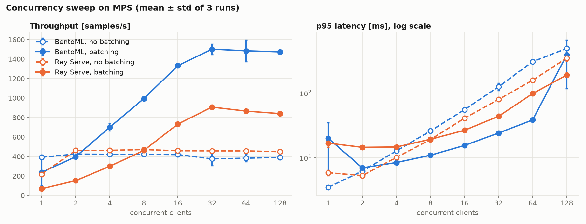
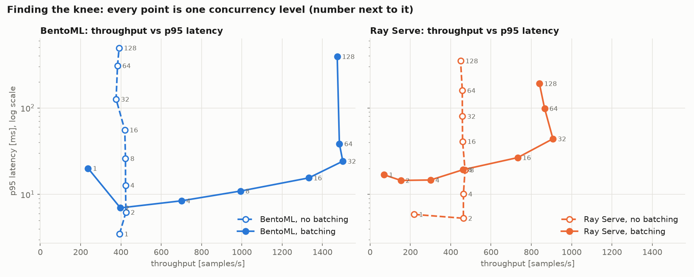
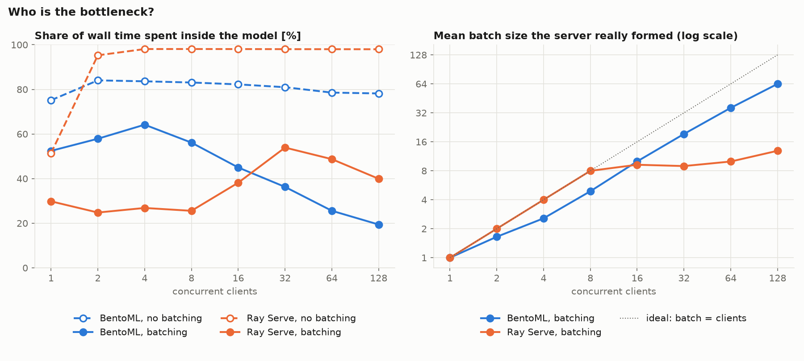

# Benchmark results

Generated by `benchmark/make_report.py` from `results/raw*.jsonl`.

Device: **MPS**, window 60 s after 15 s warm-up, 3 repeats per point (mean ± std), 1 image per request. `max_batch_size=64`; BentoML `max_latency_ms=1000`; Ray Serve `batch_wait_timeout_s=0.005`.

Power: 96/96 measurements on AC power, 0 in Low Power Mode.

## BentoML: without vs with dynamic batching

| Concurrency | Throughput no batching [samples/s] | Throughput with batching [samples/s] | Speed-up | p95 latency no batching [ms] | p95 latency with batching [ms] |
|---|---|---|---|---|---|
| 1 | 393 ± 8 | 237 ± 135 | 0.60× | 3.5 ± 0.1 | 20.0 ± 14.7 |
| 2 | 425 ± 1 | 398 ± 7 | 0.94× | 6.2 ± 0.1 | 7.0 ± 0.1 |
| 4 | 423 ± 4 | 700 ± 36 | 1.66× | 12.8 ± 0.4 | 8.4 ± 0.6 |
| 8 | 423 ± 4 | 994 ± 13 | 2.35× | 26.0 ± 1.2 | 10.9 ± 0.2 |
| 16 | 419 ± 7 | 1332 ± 17 | 3.18× | 55.6 ± 4.0 | 15.5 ± 0.1 |
| 32 | 376 ± 68 | 1501 ± 54 | 3.99× | 126.1 ± 16.7 | 24.2 ± 0.6 |
| 64 | 383 ± 38 | 1484 ± 111 | 3.87× | 308.2 ± 16.5 | 38.5 ± 3.0 |
| 128 | 391 ± 3 | 1473 ± 9 | 3.77× | 494.0 ± 8.3 | 392.9 ± 274.5 |

## Ray Serve: without vs with dynamic batching

| Concurrency | Throughput no batching [samples/s] | Throughput with batching [samples/s] | Speed-up | p95 latency no batching [ms] | p95 latency with batching [ms] |
|---|---|---|---|---|---|
| 1 | 219 ± 9 | 70 ± 6 | 0.32× | 5.9 ± 0.6 | 16.9 ± 2.3 |
| 2 | 463 ± 2 | 153 ± 2 | 0.33× | 5.3 ± 0.2 | 14.5 ± 0.4 |
| 4 | 463 ± 16 | 300 ± 2 | 0.65× | 10.1 ± 0.9 | 14.7 ± 0.2 |
| 8 | 471 ± 4 | 462 ± 2 | 0.98× | 19.2 ± 0.5 | 19.3 ± 0.1 |
| 16 | 459 ± 8 | 733 ± 5 | 1.60× | 41.0 ± 2.9 | 26.7 ± 0.3 |
| 32 | 458 ± 12 | 907 ± 4 | 1.98× | 80.0 ± 5.2 | 44.0 ± 0.2 |
| 64 | 458 ± 9 | 866 ± 12 | 1.89× | 159.2 ± 9.1 | 98.6 ± 2.8 |
| 128 | 449 ± 12 | 840 ± 8 | 1.87× | 350.2 ± 37.4 | 191.4 ± 2.9 |

## Tool comparison

| Concurrency | BentoML, no batching | BentoML, batching | Ray Serve, no batching | Ray Serve, batching |
|---|---|---|---|---|
| 1 | 393 samples/s, p95 3.5 ms | 237 samples/s, p95 20.0 ms | 219 samples/s, p95 5.9 ms | 70 samples/s, p95 16.9 ms |
| 2 | 425 samples/s, p95 6.2 ms | 398 samples/s, p95 7.0 ms | 463 samples/s, p95 5.3 ms | 153 samples/s, p95 14.5 ms |
| 4 | 423 samples/s, p95 12.8 ms | 700 samples/s, p95 8.4 ms | 463 samples/s, p95 10.1 ms | 300 samples/s, p95 14.7 ms |
| 8 | 423 samples/s, p95 26.0 ms | 994 samples/s, p95 10.9 ms | 471 samples/s, p95 19.2 ms | 462 samples/s, p95 19.3 ms |
| 16 | 419 samples/s, p95 55.6 ms | 1332 samples/s, p95 15.5 ms | 459 samples/s, p95 41.0 ms | 733 samples/s, p95 26.7 ms |
| 32 | 376 samples/s, p95 126.1 ms | 1501 samples/s, p95 24.2 ms | 458 samples/s, p95 80.0 ms | 907 samples/s, p95 44.0 ms |
| 64 | 383 samples/s, p95 308.2 ms | 1484 samples/s, p95 38.5 ms | 458 samples/s, p95 159.2 ms | 866 samples/s, p95 98.6 ms |
| 128 | 391 samples/s, p95 494.0 ms | 1473 samples/s, p95 392.9 ms | 449 samples/s, p95 350.2 ms | 840 samples/s, p95 191.4 ms |

## All measurements

| Tool | Batching | Concurrency | Throughput [samples/s] | p50 [ms] | p95 [ms] | p99 [ms] | Mean batch | Time in model | Server CPU [cores] | Busiest client process | Failed requests |
|---|---|---|---|---|---|---|---|---|---|---|---|
| BentoML | no | 1 | 393 ± 8 | 2.4 | 3.5 | 6.1 | 1.0 | 75% | 0.82 | 5% of a core | 0.00% |
| BentoML | no | 2 | 425 ± 1 | 4.4 | 6.2 | 9.9 | 1.0 | 84% | 0.94 | 4% of a core | 0.00% |
| BentoML | no | 4 | 423 ± 4 | 8.9 | 12.8 | 18.9 | 1.0 | 84% | 0.95 | 3% of a core | 0.00% |
| BentoML | no | 8 | 423 ± 4 | 17.8 | 26.0 | 38.1 | 1.0 | 83% | 0.95 | 2% of a core | 0.00% |
| BentoML | no | 16 | 419 ± 7 | 35.3 | 55.6 | 79.6 | 1.0 | 82% | 0.95 | 2% of a core | 0.00% |
| BentoML | no | 32 | 376 ± 68 | 82.7 | 126.1 | 258.2 | 1.0 | 81% | 0.97 | 3% of a core | 0.00% |
| BentoML | no | 64 | 383 ± 38 | 148.9 | 308.2 | 482.9 | 1.0 | 79% | 0.95 | 2% of a core | 0.00% |
| BentoML | no | 128 | 391 ± 3 | 288.0 | 494.0 | 571.5 | 1.0 | 78% | 0.95 | 3% of a core | 0.00% |
| BentoML | yes | 1 | 237 ± 135 | 2.4 | 20.0 | 33.1 | 1.0 | 52% | 0.62 | 4% of a core | 0.00% |
| BentoML | yes | 2 | 398 ± 7 | 5.1 | 7.0 | 7.8 | 1.6 | 58% | 0.70 | 3% of a core | 0.00% |
| BentoML | yes | 4 | 700 ± 36 | 5.8 | 8.4 | 9.9 | 2.6 | 64% | 0.79 | 3% of a core | 0.00% |
| BentoML | yes | 8 | 994 ± 13 | 7.9 | 10.9 | 11.7 | 4.9 | 56% | 0.75 | 3% of a core | 0.00% |
| BentoML | yes | 16 | 1332 ± 17 | 11.4 | 15.5 | 16.9 | 10.0 | 45% | 0.78 | 4% of a core | 0.00% |
| BentoML | yes | 32 | 1501 ± 54 | 18.4 | 24.2 | 27.7 | 19.3 | 36% | 0.80 | 5% of a core | 0.00% |
| BentoML | yes | 64 | 1484 ± 111 | 32.8 | 38.5 | 534.2 | 36.1 | 26% | 0.84 | 4% of a core | 0.00% |
| BentoML | yes | 128 | 1473 ± 9 | 59.4 | 392.9 | 604.6 | 64.0 | 19% | 0.87 | 4% of a core | 0.00% |
| Ray Serve | no | 1 | 219 ± 9 | 4.4 | 5.9 | 7.3 | 1.0 | 51% | 1.09 | 5% of a core | 0.00% |
| Ray Serve | no | 2 | 463 ± 2 | 4.1 | 5.3 | 7.4 | 1.0 | 95% | 2.22 | 5% of a core | 0.00% |
| Ray Serve | no | 4 | 463 ± 16 | 8.4 | 10.1 | 12.2 | 1.0 | 98% | 2.32 | 4% of a core | 0.00% |
| Ray Serve | no | 8 | 471 ± 4 | 16.6 | 19.2 | 21.9 | 1.0 | 98% | 2.32 | 4% of a core | 0.00% |
| Ray Serve | no | 16 | 459 ± 8 | 33.5 | 41.0 | 46.5 | 1.0 | 98% | 2.32 | 4% of a core | 0.00% |
| Ray Serve | no | 32 | 458 ± 12 | 67.8 | 80.0 | 88.4 | 1.0 | 98% | 2.34 | 4% of a core | 0.00% |
| Ray Serve | no | 64 | 458 ± 9 | 136.1 | 159.2 | 179.0 | 1.0 | 98% | 2.37 | 4% of a core | 0.00% |
| Ray Serve | no | 128 | 449 ± 12 | 275.0 | 350.2 | 393.7 | 1.0 | 98% | 2.38 | 4% of a core | 0.00% |
| Ray Serve | yes | 1 | 70 ± 6 | 14.2 | 16.9 | 18.2 | 1.0 | 30% | 0.79 | 3% of a core | 0.00% |
| Ray Serve | yes | 2 | 153 ± 2 | 13.0 | 14.5 | 15.9 | 2.0 | 25% | 0.89 | 3% of a core | 0.00% |
| Ray Serve | yes | 4 | 300 ± 2 | 13.2 | 14.7 | 16.0 | 4.0 | 27% | 1.14 | 3% of a core | 0.00% |
| Ray Serve | yes | 8 | 462 ± 2 | 17.3 | 19.3 | 20.8 | 8.0 | 26% | 1.55 | 3% of a core | 0.00% |
| Ray Serve | yes | 16 | 733 ± 5 | 21.9 | 26.7 | 28.6 | 9.2 | 38% | 2.49 | 4% of a core | 0.00% |
| Ray Serve | yes | 32 | 907 ± 4 | 35.3 | 44.0 | 48.5 | 9.0 | 54% | 3.28 | 5% of a core | 0.00% |
| Ray Serve | yes | 64 | 866 ± 12 | 72.2 | 98.6 | 111.2 | 10.0 | 49% | 3.18 | 5% of a core | 0.00% |
| Ray Serve | yes | 128 | 840 ± 8 | 156.1 | 191.4 | 210.3 | 12.9 | 40% | 3.00 | 4% of a core | 0.00% |

## CPU instead of MPS (contrast run)

### BentoML on CPU

| Concurrency | Throughput no batching [samples/s] | Throughput with batching [samples/s] | Speed-up | p95 latency no batching [ms] | p95 latency with batching [ms] |
|---|---|---|---|---|---|
| 1 | 818 ± 7 | 481 ± 303 | 0.59× | 1.3 ± 0.0 | 6.8 ± 6.5 |
| 8 | 958 ± 41 | 1078 ± 49 | 1.13× | 8.6 ± 0.6 | 9.2 ± 0.8 |
| 32 | 915 ± 28 | 1183 ± 24 | 1.29× | 35.2 ± 3.0 | 27.6 ± 1.8 |

| Tool | Batching | Concurrency | Throughput [samples/s] | p50 [ms] | p95 [ms] | p99 [ms] | Mean batch | Time in model | Server CPU [cores] | Busiest client process | Failed requests |
|---|---|---|---|---|---|---|---|---|---|---|---|
| BentoML | no | 1 | 818 ± 7 | 1.2 | 1.3 | 1.5 | 1.0 | 54% | 3.87 | 8% of a core | 0.00% |
| BentoML | no | 8 | 958 ± 41 | 7.9 | 8.6 | 12.2 | 1.0 | 68% | 4.05 | 4% of a core | 0.00% |
| BentoML | no | 32 | 915 ± 28 | 32.2 | 35.2 | 49.4 | 1.0 | 64% | 4.02 | 4% of a core | 0.00% |
| BentoML | yes | 1 | 481 ± 303 | 2.8 | 6.8 | 8.1 | 1.0 | 32% | 3.54 | 8% of a core | 0.00% |
| BentoML | yes | 8 | 1078 ± 49 | 7.0 | 9.2 | 10.7 | 4.7 | 47% | 3.89 | 5% of a core | 0.00% |
| BentoML | yes | 32 | 1183 ± 24 | 24.3 | 27.6 | 33.5 | 19.3 | 48% | 3.84 | 4% of a core | 0.00% |

## Does adaptive batching remember past traffic? (`benchmark/hysteresis.py`)

One server, phases run back to back (30 s windows, 3 s warm-up).

| Tool | Step | Phase | Clients | Throughput [samples/s] | p50 [ms] | p95 [ms] | Mean batch |
|---|---|---|---|---|---|---|---|
| BentoML | 1 | fresh | 1 | 399 | 2.5 | 2.6 | 1.0 |
| BentoML | 2 | burst | 128 | 1745 | 57.2 | 205.8 | 64.0 |
| BentoML | 3 | after burst | 1 | 23 | 40.8 | 67.1 | 1.0 |
| BentoML | 4 | after burst, later | 1 | 158 | 2.5 | 19.5 | 1.0 |
| BentoML | 5 | burst | 128 | 1677 | 56.6 | 221.5 | 64.0 |
| BentoML | 6 | after burst | 1 | 31 | 30.3 | 52.3 | 1.0 |
| BentoML | 7 | restarted server | 1 | 414 | 2.4 | 2.6 | 1.0 |
| Ray Serve | 1 | fresh | 1 | 83 | 12.0 | 13.3 | 1.0 |
| Ray Serve | 2 | burst | 128 | 790 | 164.4 | 210.5 | 12.0 |
| Ray Serve | 3 | after burst | 1 | 86 | 11.5 | 13.0 | 1.0 |
| Ray Serve | 4 | after burst, later | 1 | 84 | 11.9 | 13.1 | 1.0 |
| Ray Serve | 5 | burst | 128 | 836 | 156.9 | 194.7 | 13.2 |
| Ray Serve | 6 | after burst | 1 | 82 | 12.2 | 13.1 | 1.0 |
| Ray Serve | 7 | restarted server | 1 | 83 | 12.1 | 12.9 | 1.0 |

## Who is the bottleneck? (`benchmark/find_bottleneck.py`, 30 s windows on MPS)

| Tool | Batching | Clients | Throughput [samples/s] | GPU utilisation | Time in model | Model ms/call | Mean batch | Server CPU by process [cores] |
|---|---|---|---|---|---|---|---|---|
| BentoML | no | 1 | 426 | 58% | 76% | 1.79 | 1.0 | bentoml worker (HTTP + model) 0.81 |
| BentoML | no | 32 | 451 | 61% | 84% | 1.87 | 1.0 | bentoml worker (HTTP + model) 0.94 |
| BentoML | yes | 1 | 412 | 56% | 74% | 1.80 | 1.0 | bentoml worker (HTTP + model) 0.80 |
| BentoML | yes | 32 | 1607 | 36% | 38% | 4.70 | 19.8 | bentoml worker (HTTP + model) 0.77 |
| Ray Serve | no | 1 | 224 | 32% | 52% | 2.31 | 1.0 | ray replica (model) 0.65, ray proxy (HTTP) 0.36, other 0.04 |
| Ray Serve | no | 32 | 465 | 59% | 98% | 2.11 | 1.0 | ray replica (model) 1.48, ray proxy (HTTP) 0.78, other 0.05 |
| Ray Serve | yes | 1 | 84 | 14% | 27% | 3.23 | 1.0 | ray replica (model) 0.37, ray proxy (HTTP) 0.19, other 0.05 |
| Ray Serve | yes | 32 | 899 | 41% | 53% | 5.36 | 9.1 | ray replica (model) 1.62, ray proxy (HTTP) 1.53, other 0.07 |

Cost of the pieces of one request, measured in-process without HTTP:

| Step | Time [ms] |
|---|---|
| JSON parsing | 0.004 |
| base64 decoding | 0.006 |
| model, batch of 1 (incl. copy to and from the GPU) | 1.90 |
| model, batch of 64 | 6.41 (0.100 per image) |
| whole `predict` for 1 image | 1.69 |
